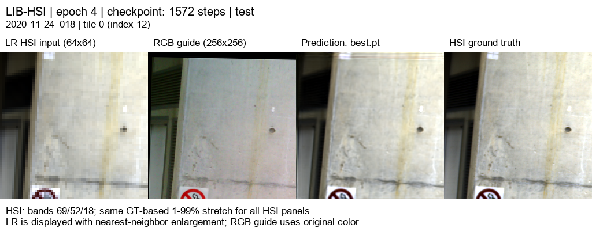
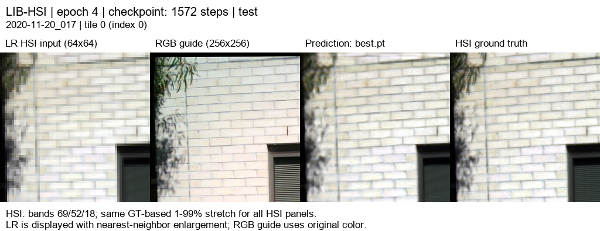
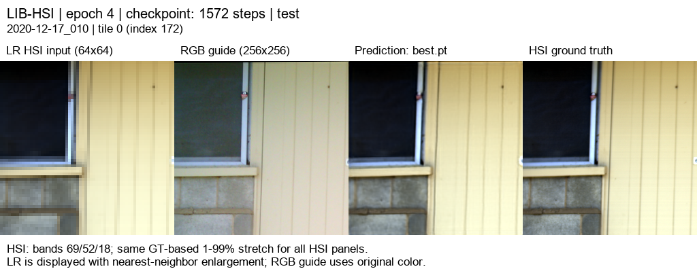
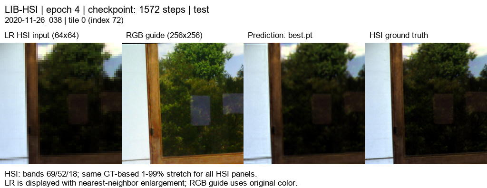
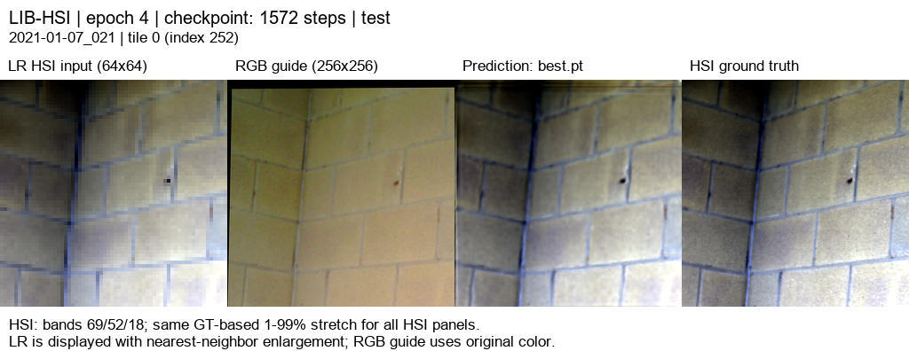

# RGB-HSI-SR

고해상도 RGB의 공간 정보를 활용해 저해상도 HSI의 공간 해상도를 높이는 개인 연구입니다. SSA-MRN을 기반으로 분광 압축, RGB별 복원 경로, 공동 디코더와 손실 함수를 비교했습니다.

LIB-HSI **204밴드**, 합성 **area ×4** 축소를 사용했습니다. 독립 장면 분할은 **train 393 / validation 45 / test 75**이며, 시험 평가는 256×256 **300타일**입니다. 합성 축소 평가를 실제 센서의 HR-HSI 복원 정확도로 해석하지 않습니다.

[알고리즘 설명](RGB-HSI/docs/research.md) · [코드·폴더·실행 안내](RGB-HSI/README.md) · [204밴드 웹뷰어](https://biyonghiyon.github.io/RGB-HSI-SR/ssa-mrn/)

## 기준 연구 · HSI 경계 손실

17특징·RGB별 독립 core·공동 디코더·23탭 확대·LR 평균 일관성 보정에 HSI 경계 손실을 더했습니다. validation 45장면의 MSE로 강도를 선택했습니다. 같은 타일 평가의 최근 완료 모델 중 **PSNR·SAM이 가장 좋은 14번 실험**을 대표 연구로 유지했습니다. 평균 MSE는 고주파 모델의 저학습률 추가 학습(12번 실험)이 더 낮습니다.

| 시험 75장면 평균 | MSE ↓ | PSNR dB ↑ | SAM ° ↓ |
|---|---:|---:|---:|
| 23탭 + LR 보정 | 0.0011539606 | 30.0649 | 2.44504 |
| 동일 학습량 대조군 | 0.0004378418 | 34.3916 | 2.15071 |
| **HSI 경계 손실** | **0.0004376169** | **34.3948** | **2.14986** |

대조군 대비 PSNR **+0.003158 dB**, SAM **-0.000849°**로 개선 폭은 매우 작습니다. 12번 실험보다 평균 MSE는 약 0.105% 높으며, 시각적인 흐릿함을 해결했다고 결론짓지 않습니다. 단일 seed와 반복 확인한 시험셋의 한계가 있습니다.

[상세 보고서·학습 그래프·전체 수치](RGB-HSI/experiments/14_hsi_gradient_loss/README.md)

왼쪽부터 **LR HSI · RGB 입력 · 예측 · 정답**입니다. 고정된 서로 다른 시험 장면의 tile 0이며, HSI 패널에는 같은 대비를 적용했습니다.

## 다른 실험

실험은 오래된 순서로 정렬했습니다. 후보와 best는 validation으로 선택하며 test는 선택 후 보고에 사용합니다. 검증 완료는 validation 전용 비교, 평가 완료는 전체 test 평가를 확보한 상태입니다.

| 실험 | 변경한 내용 | 확인된 결과 | 상태 | 개선 여부 |
|---|---|---|:---:|:---:|
| [1. 8특징 분광 압축](RGB-HSI/experiments/1_latent_compression/README.md) | 204밴드를 8특징으로 압축했습니다. | PSNR 32.3048 dB · SAM 2.3161° | 평가 완료 | 비교 기준 |
| [2. RGB 정합과 256 타일](RGB-HSI/experiments/2_registration_tiles/README.md) | RGB 정합 보정과 타일 크기를 변경했습니다. | PSNR +0.1769 dB · SAM -0.0040°; 조건 동시 변경 | 평가 완료 | 직접 비교 불가 |
| [3. 그룹 분광 압축과 23탭 확대](RGB-HSI/experiments/3_grouped_compression/README.md) | 그룹 압축·확대 방식·평가 크기를 변경했습니다. | full256 PSNR 30.7574 dB · SAM 2.0893° | 평가 완료 | 직접 비교 불가 |
| [4. RGB별 독립 복원 경로](RGB-HSI/experiments/4_rgb_independent_branches/README.md) | R/G/B 독립 경로와 타일 평가를 적용했습니다. | PSNR 34.0530 dB · SAM 2.2057°; 평가 방식 변경 | 평가 완료 | 직접 비교 불가 |
| [5. 내부 Bilinear 보간](RGB-HSI/experiments/5_bilinear_resampling/README.md) | core 내부 축소·확대를 Bilinear로 변경했습니다. | PSNR -0.2633 dB · SAM +0.0133° | 평가 완료 | 개선 없음 |
| [6. 17특징과 분광 방향 손실](RGB-HSI/experiments/6_spectral_features_loss/README.md) | 17특징·분광 손실·23탭 복구를 적용했습니다. | PSNR 34.0611 dB · SAM 2.2006°; 여러 변경 포함 | 평가 완료 | 부분 개선 |
| [7. LR 평균 일관성 보정](RGB-HSI/experiments/7_lr_mean_consistency/README.md) | 같은 가중치의 출력에 LR 평균 보정을 적용했습니다. | PSNR 34.2173 dB · SAM 2.1625° | 평가 완료 | 개선 |
| [8. 공동 분광 디코더](RGB-HSI/experiments/8_joint_decoder/README.md) | RGB별 특징을 합쳐 204밴드를 공동 복원했습니다. | PSNR 34.2831 dB · SAM 2.1570° | 평가 완료 | 개선 |
| [9. 축소 학습셋의 구조 후보 비교](RGB-HSI/experiments/9_validation_candidate_search/README.md) | 155장면에서 정합·분광 압축·고주파 후보를 비교했습니다. | validation만 평가; 후보별 공간·분광 이득 혼재 | 검증 완료 | 판단 보류 |
| [10. 후보의 추가 학습 비교](RGB-HSI/experiments/10_candidate_extended_training/README.md) | 후보 학습을 30에폭까지 늘리고 저학습률 효과를 확인했습니다. | validation만 평가; 고주파 후보 PSNR +0.0356 dB | 검증 완료 | 판단 보류 |
| [11. RGB 고주파 게이트](RGB-HSI/experiments/11_rgb_gated_detail/README.md) | RGB 고주파 보정 경로를 추가했습니다. | PSNR 34.2533 dB · SAM 2.1593°; 기준보다 악화 | 평가 완료 | 개선 없음 |
| [12. 고주파 모델의 저학습률 추가 학습](RGB-HSI/experiments/12_detail_finetuning/README.md) | 고주파 모델을 저학습률로 추가 학습했습니다. | PSNR 34.3929 dB · SAM 2.1532°; 평균 MSE 최저 | 평가 완료 | 개선 |
| [13. 공동 디코더의 저학습률 대조](RGB-HSI/experiments/13_joint_finetuning_control/README.md) | 고주파 경로 없는 모델도 같은 저학습률로 추가 학습했습니다. | validation PSNR +0.00507 dB · SAM -0.00395° | 검증 완료 | 판단 보류 |
| [14. HSI 경계 손실 비교](RGB-HSI/experiments/14_hsi_gradient_loss/README.md) | 동일 학습량 대조군과 경계 손실 네 강도를 비교했습니다. | 대조군 대비 PSNR +0.003158 dB · SAM -0.000849° | 평가 완료 | 미세 개선 |

**판정 기준:** 개선은 같은 조건에서 주요 지표가 함께 좋아진 경우, 미세 개선은 그 차이가 매우 작은 경우입니다. 부분 개선은 지표 또는 변경 조건에 따라 이득이 엇갈린 경우이며, 개선 없음은 향상을 확인하지 못한 경우입니다. 최종 test가 없는 후보는 판단 보류로 표시했습니다. 평가 조건이 달라지면 직접 비교 불가로 표시했습니다. 단일 seed의 관측 이득을 통계적으로 확정된 개선으로 주장하지 않습니다.

## 원 논문 재현 · 내부 특징 차원 비교

원 논문 기반 구조의 SSAI 내부 특징 차원 4와 6을 같은 환경에서 비교한 참고 결과입니다. RGB-HSI 실험과 입력·데이터·지표 정의가 다르므로 아래 PSNR을 RGB-HSI 결과와 직접 비교하지 않습니다. 새 PAN–MS 연구는 이 저장소에서 진행하지 않습니다.

| 모델 | 센서 | best 저장 epoch | RR PSNR ↑ | SAM ↓ | ERGAS ↓ | SCC ↑ | Q2n ↑ | FR Dλ ↓ | Ds ↓ | 잠정 QNR ↑ |
|---|---|---:|---:|---:|---:|---:|---:|---:|---:|---:|
| 01_GF2_k4_s42 | GF2 | 99 | 46.587822 | 0.955084 | 0.890096 | 0.982660 | 0.968984 | 0.036272 | 0.058463 | 0.907446 |
| 01_GF2_k6_s42 | GF2 | 99 | 46.492615 | 0.966894 | 0.899794 | 0.982344 | 0.968598 | 0.038127 | 0.057340 | 0.906784 |
| 01_QB_k4_s42 | QB | 98 | 37.457805 | 4.955422 | 4.112056 | 0.977000 | 0.922997 | 0.052675 | 0.045376 | 0.904589 |
| 01_QB_k6_s42 | QB | 98 | 37.424099 | 4.968923 | 4.125665 | 0.976664 | 0.922233 | 0.053281 | 0.046464 | 0.903233 |
| 01_WV3_k4_s42 | WV3 | 100 | 37.437113 | 3.474541 | 2.590595 | 0.977942 | 0.874478 | 0.019815 | 0.036099 | 0.944996 |
| 01_WV3_k6_s42 | WV3 | 99 | 37.407970 | 3.605403 | 2.629494 | 0.975804 | 0.880986 | 0.018715 | 0.031831 | 0.950254 |

같은 CPU FP32 코드로 각 모델의 RR·FR 전체 20장씩 평가했습니다. PSNR은 밴드별 평균·peak 2047 정의이며 GF2에도 적용했습니다. QNR·Q2n·SCC의 MATLAB 구현 대응은 미확인이므로 FR 지표는 잠정 수치입니다. validation 다수결로 선택한 차원 4를 test로 변경하지 않았습니다.

[재현 조건과 해석](RGB-HSI/references/paper_reproduction/README.md) · [참고 원문](https://github.com/BIYONGHIYON/CtrS/blob/main/SSA-MRN/experiments/12_feature_dimension/README.md)
