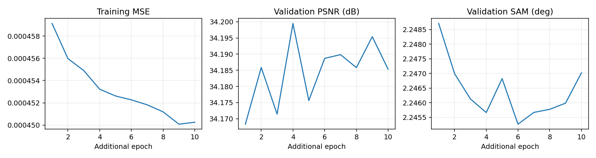

# 공동 디코더의 저학습률 대조

**변경 내용:** 고주파 경로 없는 모델도 같은 저학습률로 추가 학습했습니다.

| 확인된 결과 | 상태 | 개선 여부 |
|---|---|---|
| validation PSNR +0.00507 dB · SAM -0.00395° | 검증 완료 | **판단 보류** |

## 1. 목적과 상태

고주파 경로의 이득과 저학습률 추가 학습의 효과를 비교하기 위해 8번 실험에도 1e-5로 10에폭 추가 학습했습니다. 2026-10-06 16:06:26–16:37:37(KST), exit0으로 완료했습니다. 검증 MSE 최소인 추가 4에폭을 선택했습니다. test는 선택에 사용하거나 별도로 평가하지 않았습니다.

## 2. 변경한 구조와 비교 조건

8번 실험 best99의 가중치만 로드하고 Adam·에폭·best 점수를 초기화했습니다. 전체 train393/validation45, 204밴드, HR256/LR64, K4·17특징·공동 디코더, area×4·23탭, MSE+0.01 분광 손실, LR 보정·정합 마스크·배치·seed42를 유지했습니다. 12번 실험와 주요 학습 조건 24개를 비교했습니다. 고주파 경로는 없는 모델입니다.

## 3. 정량 결과

validation45 장면 평균입니다.

| 모델 | MSE ↓ | PSNR dB ↑ | SAM ° ↓ |
|---|---:|---:|---:|
| 8번 실험 원래 best99 · 같은 평가 프로토콜의 재평가 | 0.0004934323 | 34.1022 | 2.25140 |
| 12번 실험 추가 학습 | 0.0004850071 | 34.1944 | 2.24961 |
| 13번 실험 · 8번 실험 추가 학습 | 0.0004847384 | 34.1995 | 2.24567 |

첫 행은 [기존 matched 검증](../10_candidate_extended_training/README.md)의 Linux 재평가 수치이므로 장치 차이도 함께 고려합니다. [전체·장면별 검증과 10개 에폭](results/validation_results.json).

## 4. 기준선 대비 차이와 해석

동일 Windows 평가 조건의 12번 실험 대비 PSNR +0.00507dB, SAM −0.00395°, MSE −0.0000002687입니다. 더 단순한 8번 실험의 검증 수치가 조금 더 좋았지만 차이가 작고 단일 seed입니다. 12번 실험의 test 숫자와 이 validation 숫자를 직접 비교하지 않습니다.

## 5. 학습·평가 그래프

## 6. 결과 이미지

이 실험은 다음 모델의 기반을 고르는 검증 전용 비교입니다. test 평가·test5종 이미지는 생성하지 않았습니다. 경계 손실 후속 실험의 선택 모델에서 전체 test와 고정5종 이미지를 생성했습니다.

## 7. 재현 자료

Run `20261006-160625-01cb8ea06a54`, 서버 `C:\CtrS-rgb-detail\SSA-MRN\experiments\checkpoints\remote-runs-warm07`의 해당 run에 best/latest를 보존했습니다. best 추가4에폭 SHA-256: `025101836f8f69b9d9fa20bbbcadae2a8d46667dfedbe78494817d21c677cffd`. 시작 8번 실험 SHA-256: `5e126b17f0d95f445e8226fce401d0891593b245b737e73dc2810a3e4510d704`. [시작 상태 기록](results/start_state.json)을 보관했습니다.

## 8. 개선 여부와 다음 단계

**판정: 판단 보류입니다.**

검증 비교에서 고주파 경로의 뚜렷한 이득이 확인되지 않아 8번 실험을 경계 손실 실험의 기반으로 사용했습니다. 한 번의 비교로 구조의 우열을 확정하지 않습니다. 합성 축소 결과이며 실제 센서 HR-HSI 정답 성능이 아닙니다.
